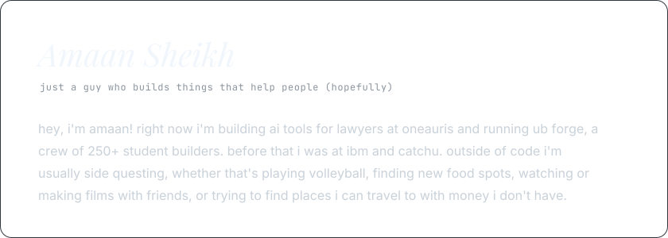

<picture>
  <source media="(prefers-color-scheme: dark)" srcset="./assets/card-dark.svg">
  <source media="(prefers-color-scheme: light)" srcset="./assets/card-light.svg">
  
</picture>

<picture>
  <source media="(prefers-color-scheme: dark)" srcset="https://readme-typing-svg.demolab.com?font=JetBrains+Mono&size=13&duration=3200&pause=1600&color=8B949E&center=true&vCenter=true&width=560&lines=Previously+at+IBM;Founder+of+UB+Forge%2C+250%2B+student+builder+community;Building+OneAuris%2C+AI+for+lawyers">
  <source media="(prefers-color-scheme: light)" srcset="https://readme-typing-svg.demolab.com?font=JetBrains+Mono&size=13&duration=3200&pause=1600&color=59636E&center=true&vCenter=true&width=560&lines=Previously+at+IBM;Founder+of+UB+Forge%2C+250%2B+student+builder+community;Building+OneAuris%2C+AI+for+lawyers">
  
</picture>

[amaans.dev](https://amaans.dev) &nbsp;·&nbsp; [linkedin](https://linkedin.com/in/amaansheikhme) &nbsp;·&nbsp; [email](mailto:amaansheikhme@gmail.com) &nbsp;·&nbsp; [ubforge.com](https://ubforge.com)

<picture>
  <source media="(prefers-color-scheme: dark)" srcset="https://raw.githubusercontent.com/AmaanOMO/AmaanOMO/output/github-snake-dark.svg">
  <source media="(prefers-color-scheme: light)" srcset="https://raw.githubusercontent.com/AmaanOMO/AmaanOMO/output/github-snake.svg">
  
</picture>

